# episode-close — traced steps

Golden day: Aranath to Sarn Athrad — day 1

```mermaid
flowchart LR
    s0["Need<br/><i>resolve_from_outcome</i>"]
    s1["Need<br/><i>update_streak_counters</i>"]
    s2["Memory<br/><i>encode_episode</i>"]
    s3["Past<br/><i>detect_patterns</i>"]
    s4["Forgotten<br/><i>decay_pass</i>"]
    s5["Belief<br/><i>belief_fade_pass</i>"]
    s6["Past<br/><i>close_episode_memory</i>"]
    s7["Temperament<br/><i>regress</i>"]
    s8["Feeling<br/><i>derive_feeling</i>"]
    s9["Relation<br/><i>decay_all</i>"]
    s10["Reflection<br/><i>maybe_reflect</i>"]
    s0 --> s1
    s1 --> s2
    s2 --> s3
    s3 --> s4
    s4 --> s5
    s5 --> s6
    s6 --> s7
    s7 --> s8
    s8 --> s9
    s9 --> s10

```



### Need — `resolve_from_outcome()` `app/mind/needs.py`

_What the Mind lacks and asks of the Episode: something the body or spirit wants (food, water, rest, healing, relief from the shadow) or an open loop it carries (a Thread)._

- **reads**: Fate
- **writes**: Need
- **example in**:
  ```json
  [{"episode": {"id": "ep-08", "game_id": "middle_earth", "character_id": "142", "episode_ref": "trip:id-09:day:1", "status": "narrated", "episode_idx": 1, "episode_date": "…", "events": "…", "narrator_payload": "…", "config_snapshot": "…"}}, {"outcome": {"fate": "living", "meals": [{"food": "a ration of road-bread and dried fruit", "slot": "midday", "slug": "trail_rations", "drink": "waterskin", "itemId": 3845, "energyBonus": 4, "waterLitres": 0.375}, {"food": "a ration of road-bread and dried fr…
  ```
- **example out**:
  ```json
  0
  ```

### Need — `update_streak_counters()` `app/mind/needs.py`

_What the Mind lacks and asks of the Episode: something the body or spirit wants (food, water, rest, healing, relief from the shadow) or an open loop it carries (a Thread)._

- **reads**: Episode
- **writes**: Need
- **example in**:
  ```json
  [{"episode": {"id": "ep-08", "game_id": "middle_earth", "character_id": "142", "episode_ref": "trip:id-09:day:1", "status": "narrated", "episode_idx": 1, "episode_date": "…", "events": "…", "narrator_payload": "…", "config_snapshot": "…"}}]
  ```
- **example out**:
  ```json
  null
  ```

### Memory — `encode_episode()` `app/mind/memory.py`

_An impression a Mind kept from something it lived._

- **reads**: Event
- **writes**: Memory
- **rules (tests)**:
  - `tests/test_c20_evocation.py::test_unwordable_items_never_encode` — Items without a reading or subject resolve no impression by
- **example in**:
  ```json
  [{"episode": {"id": "ep-08", "game_id": "middle_earth", "character_id": "142", "episode_ref": "trip:id-09:day:1", "status": "narrated", "episode_idx": 1, "episode_date": "…", "events": "…", "narrator_payload": "…", "config_snapshot": "…"}}]
  ```
- **example out**:
  ```json
  {"encoded": 15, "absorbed": 1, "born_consolidated": 0}
  ```

### Past — `detect_patterns()` `app/mind/memory.py`

_What the Mind lived and kept: its Memories, the Forgotten and the patterns repetition left._

- **reads**: Episode, Tag
- **writes**: Memory
- **example in**:
  ```json
  [{"episode": {"id": "ep-08", "game_id": "middle_earth", "character_id": "142", "episode_ref": "trip:id-09:day:1", "status": "narrated", "episode_idx": 1, "episode_date": "…", "events": "…", "narrator_payload": "…", "config_snapshot": "…"}}, {"idx": 1}, {"w": {"decay": 0.85, "forget_threshold": 0.2, "fixed_threshold": 0.8, "w_severity": 0.35, "w_novelty": 0.25, "w_emotional": 0.15, "w_attention": 0.15, "w_perception": 0.1, "alpha": 0.4, "beta": 0.4, "gamma": 0.2, "lambda_recency": 0.3}}]
  ```
- **example out**:
  ```json
  {"formed": 0, "faded": 0}
  ```

### Forgotten — `decay_pass()` `app/mind/memory.py`

_A Memory the Mind has lost: kept as a trace with the day it was lost so the Mind's history can be seen, but never evoked again._

- **reads**: Memory
- **writes**: Memory, Forgotten
- **rules (tests)**:
  - `tests/test_c16_people.py::test_trivia_evoked_daily_never_consolidates` — The road-bread memory fixed at importance 0.06 because every meal
  - `tests/test_c16_people.py::test_intense_memory_outlives_trivia` — A frightening memory decays at the sticky rate — the corpse
  - `tests/test_c16_people.py::test_consolidated_still_fades_at_a_crawl` — Nothing is immortal — a fixed memory nobody ever stirs again
- **example in**:
  ```json
  [{"current_episode_index": 1}]
  ```
- **example out**:
  ```json
  {"forgotten": 0, "consolidated": 0}
  ```

### Belief — `belief_fade_pass()` `app/mind/memory.py`

_Something the Mind holds true: a statement, how firmly it is held (from barely to a way of life) and what it is about — the world, the self, others, or what matters (a Value)._

- **reads**: Belief
- **writes**: Belief
- **example in**:
  ```json
  [{"current_episode_index": 1}]
  ```
- **example out**:
  ```json
  {"beliefs_faded": 0}
  ```

### Past — `close_episode_memory()` `app/mind/memory.py`

_What the Mind lived and kept: its Memories, the Forgotten and the patterns repetition left._

- **reads**: Episode
- **writes**: Memory, Forgotten, Past
- **example in**:
  ```json
  [{"episode": {"id": "ep-08", "game_id": "middle_earth", "character_id": "142", "episode_ref": "trip:id-09:day:1", "status": "narrated", "episode_idx": 1, "episode_date": "…", "events": "…", "narrator_payload": "…", "config_snapshot": "…"}}]
  ```
- **example out**:
  ```json
  {"encoded": 15, "forgotten": 0, "consolidated": 0, "patterns": 0, "patterns_faded": 0, "beliefs_faded": 0, "needs_released": 0, "memories_merged": 0, "memories_absorbed": 1}
  ```

### Temperament — `regress()` `app/mind/engine.py`

_The point in the Mood's own space where the Mood falls by inertia when nothing happens — the resting feeling a Mind returns to, from a hobbit's warm contentment to Celebrían's cool calm._

- **reads**: Mood, Temperament
- **writes**: Mood
- **rules (tests)**:
  - `tests/test_engine.py::test_mood_regresses_toward_the_temperament` — A kind afternoon fades: the quiet episodes carry the mood back
- **example in**:
  ```json
  [{"mood": {"cause": null, "arousal": 0.13175, "feeling": null, "valence": -0.005499999999999998, "dominant": "steady", "dominance": 0.0375}}, {"temperament": {"arousal": 0.2, "valence": 0.05, "dominance": 0.15}}, {"alpha": 0.25}]
  ```
- **example out**:
  ```json
  {"cause": null, "arousal": 0.13175, "feeling": null, "valence": -0.005499999999999998, "dominant": "steady", "dominance": 0.0375}
  ```

### Feeling — `derive_feeling()` `app/mind/engine.py`

_A literary word the engine derives for the narration by matching the live vector state — Mood, Relations, Body and how long they have held — against a declared lexicon: fear with no dominance becomes dread, long-held low valence becomes melancholy, full-grown affection and trust become deep friendship._

- **reads**: Mood
- **writes**: Feeling
- **rules (tests)**:
  - `tests/test_attitudes.py::test_provisioning_clones_every_facet` — A preset's starter belief carries subject/stance/source into the
  - `tests/test_attitudes.py::test_inverted_belief_keeps_its_facets` — When reflection turns a prejudice, the grown belief still knows
  - `tests/test_c18_personality.py::test_starter_beliefs_seed_the_brain_on_first_open` — A preset's starter beliefs clone into the fresh mind as origin='seed'
  - `tests/test_c19_reset.py::test_reset_wipes_lived_content_and_reseeds` — tests/test_c19_reset.py::test_reset_wipes_lived_content_and_reseeds
  - `tests/test_c19_reset.py::test_reset_is_idempotent` — tests/test_c19_reset.py::test_reset_is_idempotent
  - `tests/test_c20_evocation.py::test_the_felt_it_landed_encodes_with_the_memory` — How it felt through the personality is part of what a memory IS —
  - `tests/test_c24_mood.py::test_extreme_need_keeps_the_mood_honest` — Prior 'steady' + a despairing starving day must not resolve back
  - `tests/test_c24_mood.py::test_calm_day_keeps_the_running_mood` — The day's pull trajectory already landed near the prior state —
  - `tests/test_c24_mood.py::test_mind_mood_carries_its_cause_and_drops_it_at_ease` — tests/test_c24_mood.py::test_mind_mood_carries_its_cause_and_drops_it_at_ease
  - `tests/test_engine.py::test_derive_feeling_reads_the_state_as_a_word` — tests/test_engine.py::test_derive_feeling_reads_the_state_as_a_word
  - `tests/test_musings.py::test_reset_reseeds_musings_and_leaves_beliefs_alone` — tests/test_musings.py::test_reset_reseeds_musings_and_leaves_beliefs_alone
  - `tests/test_relations.py::test_lean_seeds_the_relation` — 'orcs' feared AND hated — the preset's authored lean lands as the
  - _…6 more in graph.json_
- **example in**:
  ```json
  [{"vector": {"cause": null, "arousal": 0.13175, "feeling": null, "valence": -0.005499999999999998, "dominant": "steady", "dominance": 0.0375}}, {"lexicon": [{"feeling": "dread", "when": {"fear": "…", "dominance": "…"}}, {"feeling": "deep friendship", "when": {"affection": "…", "trust": "…", "familiarity": "…"}}, {"feeling": "feared and hated", "when": {"fear": "…", "affection": "…"}}, "… 8 more"]}]
  ```
- **example out**:
  ```json
  null
  ```

### Relation — `decay_all()` `app/mind/relations.py`

_The emotional sediment a Subject leaves in the Mind: not an entity in the world but the standing sum of everything the Mind has felt about it — the love for a place, the fear of a kind, the trust in a person._

- **reads**: Relation
- **writes**: Relation
- **example in**:
  ```json
  [{"rate": 0.98}]
  ```
- **example out**:
  ```json
  null
  ```

### Reflection — `maybe_reflect()` `app/mind/reflection.py`

_The Mind's only re-reading of itself: a close-time pass that, when its trigger fires, rewrites what the Episode left — it may lend a carried cause better words, or turn a prejudice by rewriting the Conviction's facet and imprint._

- **reads**: Memory, Belief, Mood
- **writes**: Belief, Mood
- **example in**:
  ```json
  [{"episode": {"id": "ep-08", "game_id": "middle_earth", "character_id": "142", "episode_ref": "trip:id-09:day:1", "status": "narrated", "episode_idx": 1, "episode_date": "…", "events": "…", "narrator_payload": "…", "config_snapshot": "…"}}, {"character_name": "Aranath"}]
  ```
- **example out**:
  ```json
  null
  ```

## Declared steps the golden day did not exercise

- **Episode** `wake_event()` — ['Episode'] → ['Event']
- **Need** `refresh_state_needs()` — ['Condition'] → ['Need']
- **Focus** `direct()` — ['Lens'] → ['Focus']
- **Forgotten** `forget()` — ['Memory'] → ['Forgotten']
- **Decision** `choose()` — ['Need', 'Relation'] → ['Decision']
